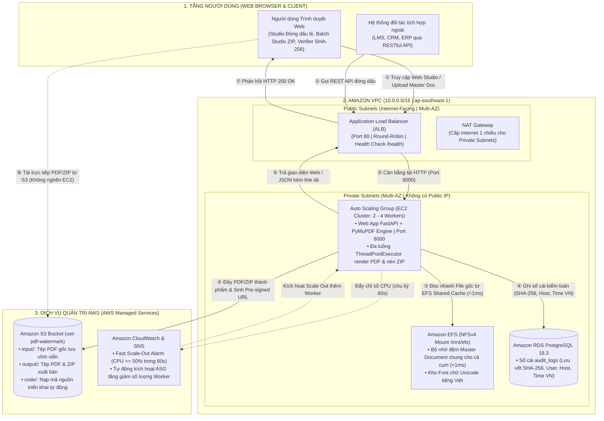

# UET Smart Watermark Platform - Nền tảng Ứng Dụng Web Đóng Dấu & Quản Trị Tài Liệu Số Trực Tuyến trên AWS Cloud 🚀

> **Học phần:** Điện toán đám mây (INT 3319 3)  
> **Khoa Công nghệ Thông tin – Trường Đại học Công nghệ, Đại học Quốc gia Hà Nội (UET - VNU)**  
> **🌐 Địa chỉ Web App Trực tuyến (Live ALB Endpoint):** [http://PDF-Watermark-ALB-281030112.ap-southeast-1.elb.amazonaws.com](http://PDF-Watermark-ALB-281030112.ap-southeast-1.elb.amazonaws.com)  
> **📚 Tài liệu API Tương tác (Swagger UI):** [http://PDF-Watermark-ALB-281030112.ap-southeast-1.elb.amazonaws.com/docs](http://PDF-Watermark-ALB-281030112.ap-southeast-1.elb.amazonaws.com/docs)

---

## 👥 1. Thông tin nhóm thực hiện

| STT | Họ và tên | Mã sinh viên | Vai trò | Mảng phụ trách chính |
|:---:|---|:---:|:---:|---|
| **1** | **Trần Nhật Hưng** | **24021507** | Nhóm trưởng | **Tính toán & Mở rộng:** Cấu hình EC2, Cân bằng tải (ALB), Tự động mở rộng (ASG), Giám sát (CloudWatch, SNS), Fast Auto-Scaling & Tối ưu chi phí FinOps. |
| **2** | **Nguyễn Nam Khánh** | **24021531** | Thành viên | **Hạ tầng & Lưu trữ Đa tầng:** Thiết kế VPC Multi-AZ, Phân quyền & Bảo mật (Security Group, IAM Role), Lưu trữ đối tượng (S3) & Bộ nhớ đệm tệp dùng chung (EFS). |
| **3** | **Đỗ Lê Duy** | **24021445** | Thành viên | **Ứng dụng & Dữ liệu:** Cơ sở dữ liệu kiểm toán (RDS PostgreSQL), Phát triển Nền tảng Web App Trực tiếp (HTML5/Canvas/WebCrypto), Xử lý đa luồng & Bắn tải chịu lỗi (Load Testing). |

---

## 🎯 2. Giới thiệu Bài toán Thực tiễn & Định hướng Ứng dụng Web Trực Tuyến

### 2.1. Vấn đề thực tiễn trong quản trị tài liệu số
Trong môi trường giáo dục đại học và doanh nghiệp, nhu cầu cấp phát hàng loạt tài liệu bảo mật cá nhân hóa (đề thi, chứng chỉ, bảng điểm, hợp đồng, bảng lương) diễn ra liên tục với số lượng rất lớn:
* **Nút thắt tải lên lặp lại (Upload Bottleneck):** Khi 1 cán bộ khảo thí cần đóng dấu 1 bộ đề thi 50 trang cho 50 phòng thi, hoặc phòng nhân sự phát hành hợp đồng cho 200 nhân viên, nếu mỗi lần tạo 1 bản đều phải upload lại file gốc nặng hàng chục MB qua Internet sẽ gây nghẽn băng thông, lãng phí thời gian và dễ gây lỗi đường truyền.
* **Nguy cơ rò rỉ và giả mạo tài liệu:** Tài liệu phát tán không có dấu vết định danh cá nhân rất dễ bị chụp ảnh, tuồn ra ngoài mà không thể truy cứu trách nhiệm. Ngược lại, tài liệu bị kẻ xấu can thiệp sửa chữa số liệu không có cách nào đối soát nhanh chóng.

### 2.2. Giải pháp: Nền tảng Ứng Dụng Web Trực Tuyến Tự Phục Vụ (Self-Service Web Platform)
Hệ thống được xây dựng dưới dạng **một ứng dụng web trực tuyến hoàn chỉnh**, cho phép người dùng thao tác trực tiếp trên trình duyệt với 5 phân hệ chức năng:

1. **Kho Lưu Trữ Tài Liệu Gốc (Master Document Library - Tab 1):**
   * Người dùng tải tệp PDF gốc lên **MỘT LẦN DUY NHẤT**.
   * Hệ thống tự động đồng bộ lên bộ nhớ đệm tốc độ cao **Amazon EFS** (`/mnt/efs/input/`) và lưu trữ bền vững vĩnh viễn trên **Amazon S3** (`input/`).
   * Tự động trích xuất metadata (số trang, dung lượng) và cấp nhãn trạng thái `Amazon EFS Cache`. Hỗ trợ dọn dẹp và xóa tài liệu an toàn.
2. **Phòng Đóng Dấu Đơn Lẻ Trực Quan (Live Watermark Studio - Tab 2):**
   * Tùy biến thông tin người nhận (Họ tên, Mã định danh), dòng chữ chìm xoay $45^\circ$, tiêu đề, con dấu đỏ bảo mật, thanh trượt độ mờ (Opacity) và cỡ chữ.
   * Tích hợp **HTML5 Live Canvas Preview thời gian thực**: Đồng bộ 2 chiều giữa ô nhập liệu và khung mô phỏng bản in trang A4 ($0\text{ms}$ độ trễ).
   * Xuất bản tệp PDF cá nhân hóa chỉ trong **$< 0.5$ giây** mà **không tốn bất kỳ byte băng thông upload nào**!
3. **Phòng Đóng Dấu Hàng Loạt Đa Luồng & Xuất Tệp ZIP (Batch Studio - Tab 3):**
   * Hỗ trợ **tải tệp CSV/Excel trực tiếp** (`.csv`, `.txt`, `.tsv`) hoặc kéo thả danh sách hàng trăm người nhận vào giao diện, kèm nút **Tải tệp CSV mẫu**.
   * Hỗ trợ nạp nhanh các bộ mẫu có sẵn (+ Nạp 5 Sinh viên, + Nạp 10 Phòng thi).
   * Tùy biến mẫu watermark động với các biến `{name}`, `{id}`, `{date}`, `{doc}` cùng đầy đủ tùy chỉnh Opacity, Font Size, Header, Footer đồng nhất với đóng dấu đơn lẻ.
   * Kích hoạt xử lý song song đa luồng (`ThreadPoolExecutor`) trên cụm EC2, tự động sinh bảng kê đối soát `kiem_dinh_manifest.csv` kèm mã băm SHA-256 từng bản.
   * Nén toàn bộ thành tệp `.ZIP` duy nhất và tải về thông qua **S3 Pre-signed URL** chỉ với 1 cú click chuột!
4. **Cổng Kiểm Định Tính Toàn Vẹn Số (Public SHA-256 Verifier - Tab 4):**
   * Kéo thả tệp PDF nghi vấn vào trình duyệt; Web Crypto API tính toán mã băm SHA-256 nội bộ trong **20ms** ngay trên máy khách (không cần tải file lên máy chủ).
   * Tự động tra cứu đối soát với cơ sở dữ liệu kiểm toán **Amazon RDS PostgreSQL** để khẳng định tính chính thống, thời gian cấp phát và người nhận gốc.
5. **Nhật Ký Kiểm Toán Phân Tán (RDS PostgreSQL Audit Log Viewer - Tab 5):**
   * Bảng kê kiểm toán thời gian thực: Mã yêu cầu (UUID), Họ tên người nhận, Mã định danh, SHA-256, Máy chủ EC2 xử lý (Worker Host IP), Thời gian cấp phát theo giờ Việt Nam (GMT+7) và thời gian thực thi (Latency ms).

---

## 🏛 3. Sơ đồ Kiến trúc & Luồng Xử Lý trên AWS

Hạ tầng được triển khai tại vùng **AWS Singapore (`ap-southeast-1`)** với dải mạng **VPC CIDR `10.0.0.0/16`**, tuân thủ nghiêm ngặt Khung kiến trúc chuẩn của AWS (AWS Well-Architected Framework):



---

## 💾 4. Mô hình Phân tầng Lưu trữ Tối ưu (Multi-Tier Storage Architecture)

Hệ thống kết hợp chặt chẽ 3 dịch vụ lưu trữ cốt lõi của AWS nhằm giải quyết triệt để bài toán: **Tốc độ xử lý – Chia sẻ dữ liệu giữa các máy chủ không trạng thái (Stateless EC2) – Độ bền bỉ dài hạn & Tối ưu chi phí FinOps**:

| Dịch vụ AWS | Loại hình lưu trữ | Phạm vi truy cập | Vai trò cụ thể trong Nền tảng Web | Tại sao không thể thiếu? |
|:---|:---|:---|:---|:---|
| **Amazon EBS (gp3)** | Block Storage (Ổ đĩa khối) | Duy nhất 1 máy chủ EC2 | Chứa hệ điều hành Ubuntu Linux, môi trường Python Virtualenv (`/opt/watermark-app/venv`), và vùng đệm xử lý tạm `/tmp/wm_work` khi CPU render trang PDF. | Cung cấp tốc độ đọc ghi IOPS tối đa cho hệ điều hành và tiến trình cục bộ của máy ảo. |
| **Amazon EFS** | Network File System (NFSv4 POSIX) | **Nhiều máy chủ EC2 cùng lúc (ReadWriteMany)** | **Bộ nhớ đệm tài liệu gốc tốc độ cao (`/mnt/efs/input/`)**: Khi đóng dấu hàng trăm bản từ 1 file gốc, tất cả các worker EC2 đọc chung file từ EFS với độ trễ $< 1\text{ ms}$, triệt tiêu 100% độ trễ tải mạng. | **Tránh lỗi thiếu file giữa các máy**: Nếu lưu cache trên EBS riêng, Máy A có file nhưng Máy B không có; EFS giúp 1 máy ghi, toàn bộ cụm thấy file ngay lập tức! |
| **Amazon S3** | Object Storage (Độ bền 11 số 9) | Toàn cầu qua Internet / API | **Kho lưu trữ bền vững vĩnh cửu**: File gốc (`input/`), toàn bộ file PDF và gói ZIP thành phẩm xuất bản (`output/`), mã nguồn triển khai (`code/main.py`), nhật ký vận hành (`debug/`). | Chi phí siêu rẻ (~0.025 $/GB), dung lượng không giới hạn, giải phóng 100% băng thông tải file ra khỏi cụm EC2 nhờ S3 Pre-signed URL. |

---

## ⚡ 5. Kết quả Kiểm thử Chịu tải Thực nghiệm (Kịch bản 2: 28 Luồng / 6 Phút)

Hệ thống đã trải qua đợt kiểm thử chịu tải cường độ cao mô phỏng kịch bản cao điểm thực tế bằng công cụ [load_test.py](file:///home/hung/code/Dynamic-PDF-Watermarking-Pipeline/load_test.py):

* **Lệnh thực thi:**
  ```bash
  python3 load_test.py --concurrency 28 --duration 360
  ```

### 📊 Bảng tổng hợp số liệu thực tế đo đạc trên cụm AWS:

| Chỉ số Đo lường (Metrics) | Kết quả Thực tế Đạt được | Ý nghĩa Kỹ thuật & Chuẩn Đánh giá |
|:---|:---:|:---|
| **Cấu hình kiểm thử** | **28 luồng đồng thời** | Đẩy áp lực tính toán CPU toàn cụm vượt ngưỡng mở rộng |
| **Thời gian thực thi** | **367 giây (~6.1 phút)** | Kiểm tra tính ổn định liên tục dưới tải cao |
| **Tài liệu kiểm thử** | `ModelOptimization.pdf` (**47 trang**) | Tác vụ nặng: Render vector và tính toán đồ họa chuyên sâu |
| **Tổng số yêu cầu gửi đi** | **1.551 requests** | Tương đương gửi liên tục ~4.2 yêu cầu mỗi giây |
| **Yêu cầu thành công (HTTP 200)** | **1.545 requests (99.61%)** | Hệ thống hoạt động tin cậy, không sập dịch vụ |
| **Yêu cầu thất bại / Timeout** | **6 requests (0.39%)** | Chỉ xuất hiện cục bộ trong vài giây chuyển giao Scale-Out |
| **Tổng số trang PDF đã đóng dấu** | **72.615 trang PDF** ($1.545 \times 47$) | Năng lực xử lý đồ họa quy mô lớn trên nền tảng Cloud |
| **Tốc độ xử lý trung bình (Avg RPS)** | **4.21 requests/giây** | Xử lý và băm kiểm định **198 trang PDF/giây** trên toàn cụm |
| **Thông lượng đỉnh (Peak RPS)** | **8.00 requests/giây** | Đạt được khi cả 4 máy chủ EC2 cùng đồng thời nhận tải |
| **Độ trễ trung vị ($P_{50}$)** | **5.709 ms** (5.7 giây) | 50% yêu cầu tệp lớn 47 trang hoàn tất dưới 5.7 giây |
| **Độ trễ phân vị $P_{90}$ / $P_{95}$** | **12.490 ms / 14.260 ms** | 95% yêu cầu nằm an toàn trong khung thời gian cho phép |
| **Độ trễ phân vị $P_{99}$** | **18.474 ms** | Đạt đỉnh trong giai đoạn đầu khi cụm chỉ có 2 máy phải gánh 28 luồng |
| **Tổng số máy chủ EC2 tham gia** | **4 máy chủ** | **Minh chứng sống cho tính năng Auto Scaling của AWS:**<br>• Worker 1 (`ip-10-0-12-190`): **610 requests (39.5%)**<br>• Worker 2 (`ip-10-0-11-226`): **610 requests (39.5%)**<br>• Worker 3 (`ip-10-0-12-180`): **245 requests (15.9%)** *(Máy mới gia nhập)*<br>• Worker 4 (`ip-10-0-11-9`): **80 requests (5.2%)** *(Máy mới gia nhập)* |

---

## 🔌 6. Đặc tả RESTful API Tích Hợp

Bên cạnh giao diện Web tương tác trực tiếp, nền tảng cung cấp đầy đủ các RESTful API phục vụ các hệ thống nghiệp vụ (LMS, ERP, HRM):

### 6.1. Tải lên tài liệu gốc (`POST /api/v1/documents/upload`)
* **Headers:** `Content-Type: multipart/form-data`
* **Form-data:** `pdf_file` (file PDF), `custom_title` (tên hiển thị tùy chọn)
* **Response (200 OK):**
```json
{
  "status": "success",
  "message": "Tài liệu gốc đã được lưu trữ thành công trên EFS/S3 sẵn sàng đóng dấu.",
  "doc_code": "ModelOptimization",
  "filename": "ModelOptimization.pdf",
  "display_name": "ModelOptimization",
  "pages_count": 47,
  "size_formatted": "6.7 MB",
  "sha256": "43916dd549ba2373024564c7d03a1154bcfa1dbfa68ab541334913222e83ee91",
  "created_at_vn": "23/11/2026 15:30:00"
}
```

### 6.2. Đóng dấu đơn lẻ từ tài liệu có sẵn (`POST /api/v1/documents/{doc_code}/watermark`)
Xử lý siêu tốc trong $< 0.5$ giây, đọc trực tiếp từ EFS Cache:
* **Request Body:**
```json
{
  "recipient_name": "Nguyễn Văn An",
  "recipient_id": "21020001",
  "diagonal_text": "BẢN SAO BẢO MẬT - Nguyễn Văn An (21020001)",
  "stamp_text": "CONFIDENTIAL",
  "diagonal_opacity": 0.22,
  "diagonal_fontsize": 38
}
```

### 6.3. Đóng dấu hàng loạt & Xuất tệp ZIP (`POST /api/v1/documents/{doc_code}/batch`)
* **Request Body:**
```json
{
  "recipients_text": "Nguyễn Văn An, 21020001\nTrần Thị Bích, 21020002",
  "diagonal_template": "BẢN SAO BẢO MẬT - {name} - {id}",
  "header_template": "Bản cấp phát nội bộ | Cấp cho: {name} ({id})",
  "footer_template": "Bản quyền tài liệu thuộc UET - VNU | Mã số: {id}",
  "stamp_text": "CONFIDENTIAL"
}
```
* **Response (200 OK):** Trả về `zip_download_url` (S3 Pre-signed URL) tải về tệp nén chứa toàn bộ các bản PDF kèm tệp bảng kê `kiem_dinh_manifest.csv`.

### 6.4. Kiểm định tính toàn vẹn tài liệu (`GET /api/v1/audit-logs/verify/{sha256}`)
Đối chiếu mã băm SHA-256 với sổ cái RDS PostgreSQL:
```json
{
  "verified": true,
  "sha256": "e634a3be9cf670263e471924f3afbb685b982760fe5fda8ffb757e74add90353",
  "document": {
    "doc_name": "ModelOptimization",
    "full_name": "Nguyễn Văn An",
    "student_id": "21020001",
    "pages_count": 47,
    "created_at_vn": "23/11/2026 15:32:15",
    "worker_host": "ip-10-0-12-190"
  },
  "message": "Tài liệu chính thống đã được xác thực tính toàn vẹn và nguồn gốc cấp phát."
}
```

---

## 🛠 7. Hướng dẫn Khởi chạy & Quản trị

### 7.1. Chạy Ứng dụng Cục bộ (Local Development)
```bash
# 1. Kích hoạt môi trường ảo Python
source .venv/bin/activate

# 2. Khởi chạy ứng dụng Web FastAPI
python3 main.py

# 3. Mở trình duyệt truy cập: http://localhost:8000
```

### 7.2. Quản trị Hạ tầng AWS Tự Động & Tiết kiệm Ngân sách (`manage_aws.py`)
Dự án tích hợp công cụ FinOps tự động hóa giúp kiểm soát chặt chẽ chi phí:
```bash
# Đánh thức toàn bộ hệ thống sẵn sàng chấm điểm (NAT, RDS, ALB, 2 EC2 và chờ Healthy):
python3 manage_aws.py wake

# Tạm dừng toàn bộ hệ thống về 0 USD/giờ:
python3 manage_aws.py sleep

# Tạm dừng EC2/RDS/NAT nhưng giữ lại ALB để cố định DNS:
python3 manage_aws.py sleep --keep-alb
```

---

## 💰 8. Bảng Ước Tính Chi Phí Hàng Tháng (Region: ap-southeast-1)

| Dịch vụ AWS | Quy mô giả định (24/7) | Mục đích sử dụng | Đơn giá tham khảo | Chi phí ước tính/tháng |
|---|---|---|---|:---:|
| **Amazon EC2 (ASG)** | 2 instances t3.small (730h) | Worker chạy Web App & đóng dấu đa luồng | ~0.0264 USD/giờ | ~42.50 USD |
| **Amazon EBS (gp3)** | 20 GB x 2 máy = 40 GB | Ổ đĩa OS & bộ đệm tạm `/tmp` | 0.096 USD/GB-tháng | ~3.84 USD |
| **Application Load Balancer** | 1 ALB (730h) + 1 LCU | Cân bằng tải HTTP Public & SSL | ~0.0252 USD/giờ + LCU | ~24.80 USD |
| **NAT Gateway** | 1 NAT Gateway (730h) + 20 GB | Cấp Internet an toàn cho Private Subnets | ~0.059 USD/giờ + data | ~44.25 USD *(~4.30 USD nếu dùng NAT Instance)* |
| **Amazon EFS** | 5 GB Standard lưu trữ NFSv4 | Shared Master Document Hub & Font Unicode | 0.36 USD/GB-tháng | ~1.80 USD |
| **Amazon S3** | 100 GB lưu trữ + 200.000 requests | Lưu trữ file gốc và file kết quả PDF/ZIP | 0.025 USD/GB-tháng | ~3.20 USD |
| **Amazon RDS** | 1 instance db.t4g.micro (PostgreSQL) | Nhật ký kiểm toán bất biến `audit_logs` | ~0.018 USD/giờ + đĩa | ~15.44 USD |
| **CloudWatch & SNS** | 5 Metrics, 3 Alarms, Email SNS | Giám sát tải & Kích hoạt ASG tự động | Ngưỡng Free Tier / 0.10$ | ~0.30 USD |
| **TỔNG CỘNG** | | | | **~136.13 USD/tháng** *(hoặc **~96.18 USD** với NAT Instance)* |

